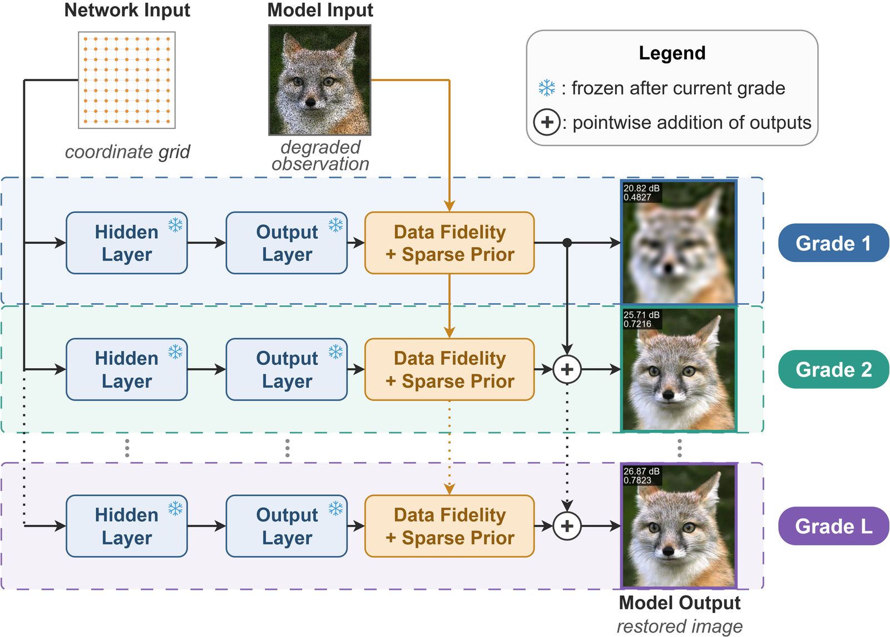

# MG-SpaIR

Code for the paper

> **MG-SpaIR: Multi-Grade Sparse-Guided Implicit Representation for Training-Data-Free Image Restoration**
> Jianmin Liao, Lei Huang, Ronglong Fang, Ashley Prater-Bennette, Lixin Shen, Yuesheng Xu
> *Journal of Mathematical Imaging and Vision* 68, 48 (2026). <https://doi.org/10.1007/s10851-026-01329-2>

<p align="center">
  
</p>

MG-SpaIR restores an image from a single degraded observation (blur, downsampling, noise, missing pixels) without training data, one grade at a time. The grade outputs in the figure are labelled with their PSNR and SSIM.

## Setup

```bash
pip install -r requirements.txt
```

Tested with Python 3.12, PyTorch 2.15, NumPy 2.5, scikit-image 0.26 and Pillow 13.

## Usage

```bash
python main.py --config configs/baboon_siren.py
```

`configs/` has one file per experiment; the comment at the top of each file gives its setting. The restored image after each grade and a `metrics.csv` with PSNR and SSIM are written to `results/<config name>/`.

The device is chosen automatically (CUDA, then Apple MPS, then CPU) and can be set with `--device`. WIRE configs do not use MPS and fall back to the CPU, because MPS gave wrong gradients for complex-valued layers in PyTorch 2.15.

## Config fields

| Field | Meaning |
|---|---|
| `IMAGE` | Ground-truth image in `data/` |
| `BLUR_SIGMA`, `SCALE`, `NOISE_STD`, `MISSING_PROB` | Degradation: standard deviation of the Gaussian blur, downsampling factor, noise level, fraction of missing pixels |
| `BACKBONE` | `"siren"` or `"wire"` |
| `NUM_GRADES`, `LAYERS_PER_GRADE`, `HIDDEN_DIM` | Number of grades, hidden layers per grade, layer width |
| `EPOCHS`, `LR` | Adam steps per grade and learning rate (one value, or one per grade) |
| `LR_DECAY` | Optional: the learning rate decays exponentially to `LR_DECAY` times its initial value over each grade |
| `THRESHOLD`, `LAMBDA` | Hard threshold `T` on the image gradients and sparsity weight `λ`; the coupling weight is `β = 2λ / T²` |
| `RESTORE_BEST` | Optional: keep the iterate with the lowest objective in each grade instead of the last one |

## Using another image

Put the image in `data/`, copy a config and change `IMAGE` and the degradation fields. The degraded observation and its mask are generated on the first run and cached in `data/degraded/`.

## Data

The degraded inputs and masks in `data/degraded/` are the ones used for the MG-SpaIR results in the paper.

- `baboon.png` is from Set14.
- `bee.png` is a crop of image `001092` of Flickr2K.
- `fox.jpg`, also shown in the figure above, is a crop of [The quick brown fox.....](https://commons.wikimedia.org/wiki/File:The_quick_brown_fox....._(15677707699).jpg) by Rolf Dietrich Brecher, licensed under [CC BY-SA 2.0](https://creativecommons.org/licenses/by-sa/2.0/). The crop and its degraded versions are shared under the same license.

The Set14 and Flickr2K images are included for research reproducibility only and remain the property of their owners.

## Acknowledgments

`wire.py` is adapted from [WIRE](https://github.com/vishwa91/wire). The SIREN backbone follows [Sitzmann et al.](https://www.vincentsitzmann.com/siren/).

## Citation

```bibtex
@article{liao2026mgspair,
  title   = {{MG-SpaIR}: Multi-Grade Sparse-Guided Implicit Representation for Training-Data-Free Image Restoration},
  author  = {Liao, Jianmin and Huang, Lei and Fang, Ronglong and Prater-Bennette, Ashley and Shen, Lixin and Xu, Yuesheng},
  journal = {Journal of Mathematical Imaging and Vision},
  volume  = {68},
  number  = {4},
  pages   = {48},
  year    = {2026},
  doi     = {10.1007/s10851-026-01329-2}
}
```

## License

The code is released under the MIT License. The images in `data/` are covered by the terms listed above. The figure is Figure 1 of the paper, which is published under CC BY 4.0.
